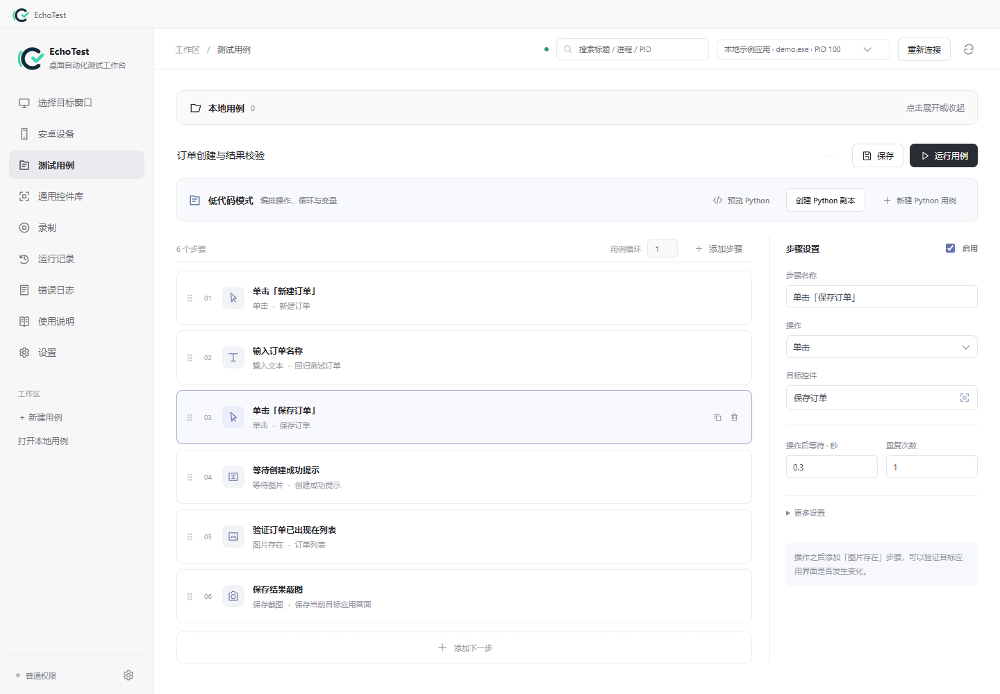
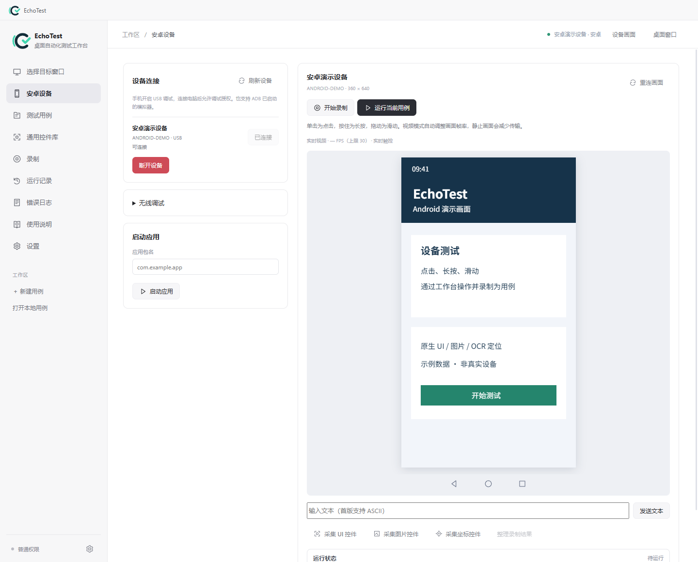
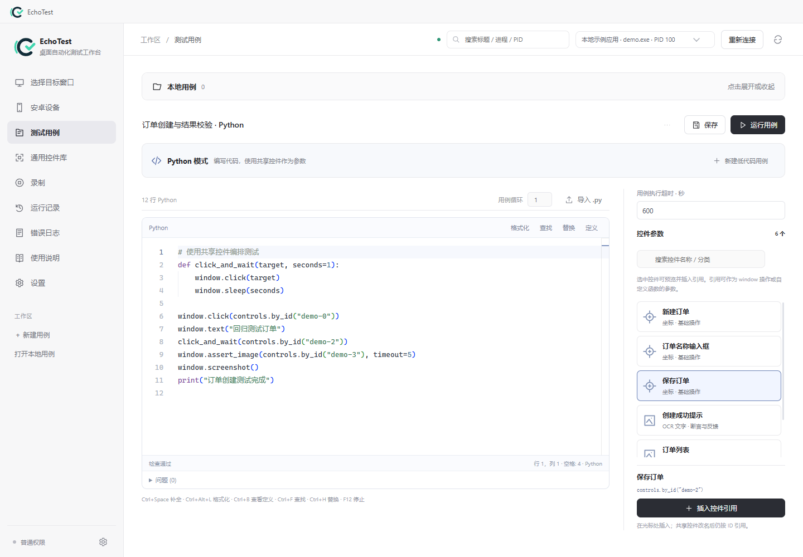
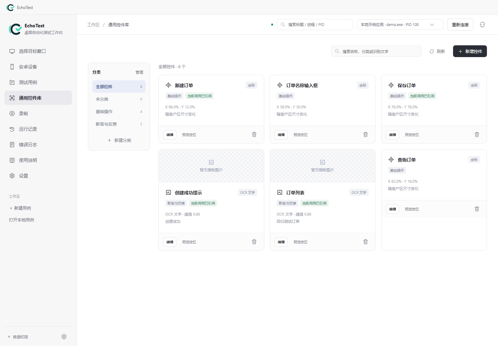
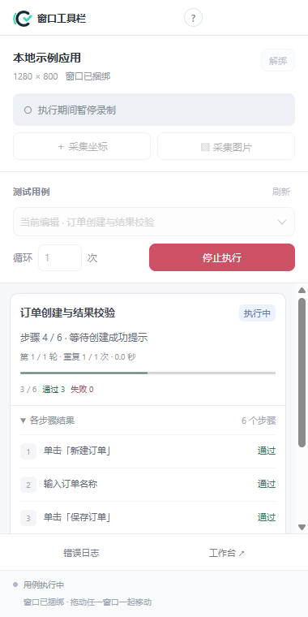

<p align="center">
  
</p>

<p align="center">
  <strong>面向 Windows 桌面应用与安卓设备的自动化测试工作台</strong><br>
  录制真实操作，复用识别控件，让每一次回归都有可追溯的结果。
</p>

<p align="center">
  <a href="https://github.com/holycoder123/echo-test/releases/tag/v1.2.0"></a>
  
  
  
</p>

<p align="center">
  <a href="https://github.com/holycoder123/echo-test/releases/latest"><strong>下载应用</strong></a> ·
  <a href="docs/user-guide.md">使用指南</a> ·
  <a href="docs/android.md">安卓接入</a> ·
  <a href="docs/mcp.md">MCP 接入</a> ·
  <a href="docs/brand/README.md">品牌资源</a> ·
  <a href="https://github.com/holycoder123/echo-test/issues">反馈问题</a>
</p>

## 从一次操作，到可重复的测试

EchoTest 将目标连接、操作录制、步骤编辑、控件识别和执行报告放在同一个 Windows 工作区。桌面目标通过独立窗口及侧边工具栏操作；安卓真机和模拟器通过设备页的实时视频操作。人工录制操作路径以快速形成用例雏形，再用低代码步骤或 Python 完善回归测试。

| 连接与录制 | 识别与编排 | 执行与回响 |
| --- | --- | --- |
| 搜索桌面窗口，或通过 USB / 无线调试连接安卓；录制操作路径 | 使用坐标、图片、OCR 或安卓原生 UI 定位；编排步骤、循环、变量与 Python | 运行或重放用例，查看执行进度、截图、HTML 报告和错误日志 |

## 1.2.0 更新

| 更新 | 现在可以做什么 |
| --- | --- |
| **安卓设备自动化** | 内置 ADB，连接真机或模拟器；实时视频、触控、系统导航、录制与重放；运行时自动进入设备画面页 |
| **安卓原生控件** | 按需采集 UI 控件树，按资源 ID、文字、无障碍描述等属性定位，支持等待、存在与消失验证 |
| **Python 编辑器升级** | 本地 Monaco 编辑器，内置 Pyright 语言服务与 Ruff 格式化，支持补全、诊断、定义查看和共享控件引用 |
| **控件与环境管理** | 附加图片模板支持重命名和预览；「设置 → 环境设置」统一管理 ADB、视频参数与运行依赖状态 |
| **界面与安装体验** | 精简连接、录制和设备页面；提供中文安装向导，升级和卸载保留用户用例与控件数据 |

完整变化见 [1.2.0 发布说明](docs/releases/1.2.0.md)，安装包见 [v1.2.0 Release](https://github.com/holycoder123/echo-test/releases/tag/v1.2.0)。

## 工作台一览

以下截图使用 1.2.0 界面与演示数据；安卓画面为示例设备内容。

低代码模式：录制后整理步骤，添加识别、等待和断言。



<details>
<summary><strong>查看安卓设备工作台</strong></summary>

连接后直接显示视频画面，设备画面下方提供返回、主界面、多任务图标，以及 UI / 图片 / 坐标控件采集入口。运行与重放在此显示执行进度。



</details>

<details>
<summary><strong>查看 Python 编辑器</strong></summary>

编写完整 Python 用例或局部脚本步骤，使用补全、诊断与格式化，并从右侧插入共享控件引用。



</details>

<details>
<summary><strong>查看共享控件库与窗口工具栏</strong></summary>

跨用例复用的控件库，支持分类、搜索和图片预览；附加模板导入后也可重命名和预览。



目标窗口旁的纵向工具栏，集中呈现录制入口和运行进度。



</details>

## 能做什么

| 能力 | 使用方式 |
| --- | --- |
| **操作录制与回放** | 桌面鼠标 / 键盘操作、工作台发出的安卓触控操作转换为可编辑用例；按 F12 停止录制或执行 |
| **图像与 OCR 识别** | 按坐标、图片或文字定位，结合多模板、遮罩与锚点配置，适用于桌面和安卓画面 |
| **通用控件库** | 在多个用例间共享坐标、图片、OCR 与安卓 UI 控件，统一维护分类、名称和识别配置 |
| **断言与等待** | 图片存在、不存在与等待图片；安卓原生控件等待、存在与消失验证 |
| **低代码与 Python 双模式** | 编排循环与变量，或编写 / 导入 Python；支持生成代码预览与独立脚本副本 |
| **Python 编辑体验** | 输入 `window.` 获得补全与参数说明，查看诊断、定义与引用；内置格式化，编辑器离线可用 |
| **本地执行报告** | 查看运行历史、步骤状态、截图、脚本输出与错误详情 |
| **MCP 接入** | 面向 Windows 目标，通过工作台截图和探索少量步骤，验证后再保存为正式用例 |
| **安卓实时操作** | 持续视频与独立触控通道，支持单击、长按、滑动、系统导航、应用启动和 ASCII 文本输入 |
| **环境设置与离线运行** | 集中配置 ADB 和视频帧率 / 分辨率 / 码率；发行包内置 Node.js、Python、ADB、视频组件、编辑器及中英文 OCR 模型 |

## 开始使用

### 下载发行包

当前版本为 **1.2.0**，前往 [GitHub Releases](https://github.com/holycoder123/echo-test/releases/latest) 选择安装版或便携版：

| 版本 | 启动方式 |
| --- | --- |
| **Windows 安装版** | 运行 `echo-test-1.2.0-setup-x64.exe`，按中文向导安装，从桌面或开始菜单启动 |
| **Windows 便携版** | 将 `echo-test-1.2.0-portable-x64.zip` 完整解压到可写目录，双击 `start.cmd` |

支持 **Windows 10/11 x64**。发行包无需另装 Node.js、Python 或 ADB；默认启动会请求 Windows 管理员权限，MCP 默认关闭，可在「设置 → MCP」中开启。下载后可用同版本 SHA256 文件校验完整性，详见 [安装版](docs/installer.md) 与 [便携版](docs/portable.md) 文档。

> 工作台运行于 Windows 10/11 x64，可连接 Windows 桌面应用与安卓设备；当前尚未接入 iOS。MCP 当前仅支持 Windows 目标。

### 完成第一条用例

1. **连接目标**：桌面应用在「选择目标窗口」中连接；安卓手机开启 USB 调试并允许电脑授权，在「安卓设备」中刷新并连接。
2. **录制操作**：桌面目标通过旁边工具栏开始录制后操作应用；安卓目标在设备页开始录制，并通过工作台画面点击、长按或滑动。点击停止或按 `F12`。
3. **整理用例**：将录制转换为用例，检查步骤，添加识别控件与图片断言。
4. **运行并检查**：保存用例并运行。安卓用例自动进入设备画面页显示进度；完整结果与报告在「运行记录」查看。

安卓录制只记录通过工作台发出的操作。原生 UI 采集取决于应用暴露的控件，Unity 等自绘界面的内部控件树尚未接入，可使用图片 / OCR 定位。安卓设备页文本发送目前支持 ASCII，中文可在手机上手动输入。连接、无线配对与控件采集详见 [安卓接入指南](docs/android.md)。

`Ctrl+S` 保存 · `Ctrl+Shift+S` 另存为 · `F1` 打开离线使用说明。新工作区从空白用例与空控件库开始。

## 开发与构建

```powershell
git clone https://github.com/holycoder123/echo-test.git
cd echo-test
.\install_dependencies.cmd
npm start
```

```powershell
npm run test:all    # 源码检查、Node 与 Python 测试
npm run test:ui     # 独立配置目录中的界面冒烟
.\build_portable.cmd
.\build_installer.cmd
```

Electron 负责工作台界面，Python / OpenCV / OCR 负责识别与用例执行，Windows 目标使用 Win32，安卓目标使用 ADB / UI Automator 与 scrcpy 视频及控制通道。Python 编辑器使用 Monaco、Pyright 和 Ruff。运行环境位于项目内的 `runtime/`；测试与打包的完整要求见 [开发与验证](docs/testing.md)。

本地构建的最新安装包、便携包及校验文件位于 `dist/latest/`，旧构建保留到 `dist/history/`。GitHub 发行包通过发布工作流独立构建并验证。

## 文档导航

| 想了解什么 | 从这里开始 |
| --- | --- |
| 连接、录制、控件识别、断言与报告 | [使用指南](docs/user-guide.md) |
| 安卓连接、实时视频、录制与原生 UI 控件 | [安卓设备接入](docs/android.md) |
| 运行环境、共享控件及本地数据管理 | [工作区详解](docs/workspace.md) |
| 安装、升级、卸载与离线分发 | [Windows 安装版](docs/installer.md) · [便携运行包](docs/portable.md) |
| 接入支持 MCP 的客户端 | [MCP 接入](docs/mcp.md) |
| Python 编辑器、双模式与脚本 API | [Python 用例与脚本](docs/python-scripts.md) |
| 代码结构、测试与发布变化 | [项目结构](docs/structure.md) · [开发与验证](docs/testing.md) · [1.2.0 发布说明](docs/releases/1.2.0.md) |
| Logo、桌面图标与分享封面 | [品牌资源及使用规范](docs/brand/README.md) |

用户用例、控件模板、录制及报告保存在本机。备份或迁移时请一并保留 `test_cases/`、`control_library/` 等数据目录，具体约定见 [工作区详解](docs/workspace.md)。

---

<p align="center"><strong>EchoTest</strong><br>每一次测试，都有回响。</p>
