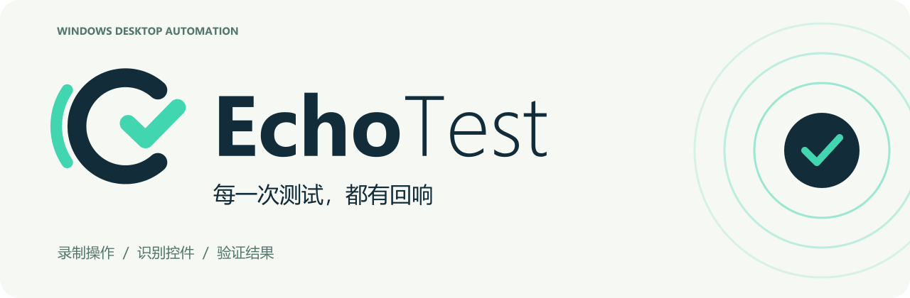

# echo test 品牌资源

依据选定的「e / 回声弧线 / 通过勾」方案重绘矢量母版。横版字标保持 `echo` 加粗、`test` 常规字重，品牌语为「每一次测试，都有回响」。



## 资源索引

| 场景 | SVG 母版 | PNG / 图标 |
| --- | --- | --- |
| 标准横版 | [logo.svg](logo.svg) | [logo.png](logo.png)，2280 × 576，透明 |
| 带品牌语横版 | [logo-tagline.svg](logo-tagline.svg) | [logo-tagline.png](logo-tagline.png)，2280 × 690，透明 |
| 竖版组合 | [logo-stacked.svg](logo-stacked.svg) | [logo-stacked.png](logo-stacked.png)，1200 × 900，透明 |
| 深色背景横版 | [logo-light.svg](logo-light.svg) | [logo-light.png](logo-light.png)，透明 |
| 单色横版 | [logo-mono.svg](logo-mono.svg) | [logo-mono.png](logo-mono.png)，透明 |
| 独立图形 | [标准](mark.svg) · [浅色](mark-light.svg) · [墨色](mark-mono.svg) · [白色](mark-white.svg) | 对应同名 PNG，576 × 576，透明 |
| 应用图标 | [浅底](app-icon.svg) · [深底](app-icon-dark.svg) | [icons/](icons/) 下 16 / 20 / 24 / 32 / 40 / 48 / 64 / 128 / 256 / 512 / 1024 px |
| Windows 桌面 / 安装器 | — | [echo-test.ico](echo-test.ico)，包含 9 个尺寸的图像帧 |
| 网页 favicon | [favicon.svg](favicon.svg) | [favicon.ico](favicon.ico) · [favicon.png](favicon.png) |
| GitHub README 横幅 | [github-banner.svg](github-banner.svg) | [github-banner.png](github-banner.png)，2560 × 840 |
| 分享封面 | [social-preview.svg](social-preview.svg) | [social-preview.png](social-preview.png)，1280 × 640 |

打开 [preview.html](preview.html) 查看品牌预览。完整资源包为项目内 `dist/echo-test-brand-kit.zip`；`dist/` 是本机构建产物，不纳入 Git。

## 使用规范

| 颜色 | 色值 | 用途 |
| --- | --- | --- |
| 深墨蓝 | `#122D39` | 主图形、字标、深色背景 |
| 薄荷青 | `#42D6B0` | 回声弧线、通过勾、品牌强调 |
| 雾白 | `#F6F8F4` | 应用图标底色和浅色展示背景 |

字标使用 Segoe UI Bold / Regular，中文使用 Microsoft YaHei，均已转为路径。SVG 不依赖系统字体或外部资源。保持比例、不旋转或拉伸，四周至少留出图形宽度 1/8 的空间。带文字组合建议宽度不低于 160 px，小尺寸使用独立图形或应用图标。深色背景使用 `logo-light` / `mark-light`，单色印刷使用 `logo-mono` / `mark-mono`。

## 应用接入

- `electron/assets/studio.svg` / `studio.png` / `studio.ico`：应用窗口、托盘、安装器与安装快捷方式。
- `electron/renderer/brand/mark.svg`：工作台标题栏、侧栏与窗口工具栏，经现有应用协议加载。
- `scripts/set-desktop-icon.ps1`：为当前项目创建「echo test」桌面入口，识别旧名称入口并备份后替换。

```powershell
powershell -NoProfile -ExecutionPolicy Bypass -File scripts/set-desktop-icon.ps1
```

桌面入口使用项目内启动脚本，默认请求管理员权限并开启 MCP。安装器使用同一 ICO，后续构建会继承新图标。

## 重新生成

以下仅供品牌维护者使用，应用运行不需要字体工具。Windows 需安装 Segoe UI 和 Microsoft YaHei。

```powershell
node scripts/python.cjs -m pip install --target .runtime/brand-tools fonttools==4.60.1
node scripts/python.cjs scripts/brand/build.py
```

更新首页截图：在 PowerShell 中先运行 `$env:ECHO_TEST_BRAND_PREVIEW='1'`，再运行 `npm run test:ui`。截图使用隔离窗口与内存中的演示数据，不连接真实目标应用；输出位于 `docs/images/`。

构建器由固定路径和字体轮廓生成 SVG，使用项目内 Electron 渲染 PNG，使用运行环境已有的 Pillow 封装 ICO，验证尺寸、透明通道与全部 ICO 帧，生成 ZIP 和 SHA256。

分享封面已备好；GitHub 的 Social preview 需在仓库 Settings 中上传 `social-preview.png`，提交文件不会自动更改此设置。
